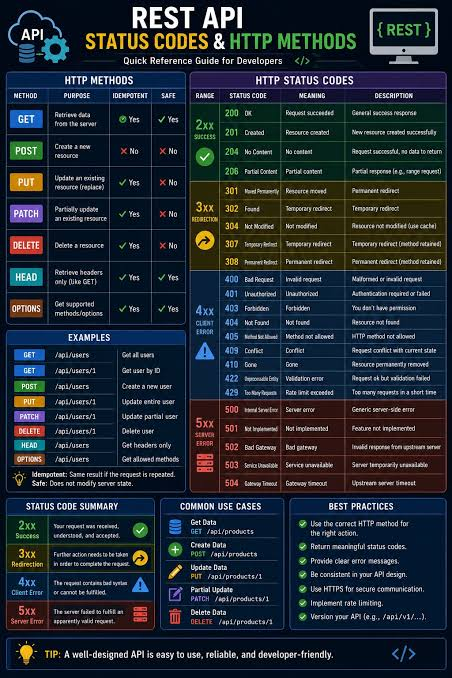

# API-Testing-Notes
API Testing Notes

# HTTP Status code

## HTTP Status Code Categories

| Code Range | Category | Meaning | Example |
|------------|----------|---------|---------|
| 1xx | Informational | Request received; processing continues | 
| 2xx | Success | Request was successfully processed | 200 Success |
| 3xx | Redirection | Further action or redirection required | 302 Temporary Redirect |
| 4xx | Client Error | Problem with the request from the client | 400 Bad Request, 404 Not Found |
| 5xx | Server Error | Server failed to process a valid request | 500 Internal Server Error |

# ALL Status codes
## HTTP Status Codes with Examples

| Status Code | Name | Example | Description |
|-------------|------|---------|-------------|
| 200 | OK | `GET /users/1` | User details retrieved successfully |
| 201 | Created | `POST /users` | New user created successfully |
| 202 | Accepted | `POST /jobs` | Request accepted for asynchronous processing |
| 204 | No Content | `DELETE /users/1` | Request successful with no response body |
| 301 | Moved Permanently | `GET /old-page` | Resource permanently redirected |
| 302 | Found | `GET /temporary-page` | Resource temporarily redirected |
| 304 | Not Modified | `GET /users/1` | Cached resource has not changed |
| 400 | Bad Request | `POST /users` with malformed JSON | Request is invalid |
| 401 | Unauthorized | `GET /profile` without valid credentials | Authentication is missing or invalid |
| 403 | Forbidden | `GET /admin` without permission | User is not authorized to access the resource |
| 404 | Not Found | `GET /users/9999` | Resource or endpoint not found |
| 405 | Method Not Allowed | `PUT /read-only-resource` | HTTP method is not supported by the endpoint |
| 408 | Request Timeout | Client takes too long to send the request | Request timed out |
| 409 | Conflict | Creating a user with a duplicate unique ID | Request conflicts with the current resource state |
| 410 | Gone | `GET /deprecated-resource` | Resource is permanently unavailable |
| 413 | Content Too Large | Uploading a file above the size limit | Request body exceeds the allowed size |
| 415 | Unsupported Media Type | Sending XML to a JSON-only endpoint | Request content type is unsupported |
| 422 | Unprocessable Content | `POST /users` with an invalid email | Request content fails semantic validation |
| 429 | Too Many Requests | Exceeding an API rate limit | Too many requests sent within a time period |
| 500 | Internal Server Error | Unexpected exception in the API | Server encountered an unexpected error |
| 501 | Not Implemented | Calling an unsupported server feature | Server does not support the requested functionality |
| 502 | Bad Gateway | Upstream service returns an invalid response | Gateway received an invalid upstream response |
| 503 | Service Unavailable | API server is temporarily overloaded | Service is temporarily unavailable |
| 504 | Gateway Timeout | Upstream service does not respond in time | Gateway timed out waiting for the upstream service |

# HTTP methods with API Examples
## HTTP Methods with Examples

| HTTP Method | Example Endpoint | Example Request | Expected Result |
|-------------|------------------|-----------------|-----------------|
| GET | `/users/101` | `GET /users/101` | Returns details of user 101; typically `200 OK` |
| POST | `/users` | `POST /users` with user data | Creates a user; typically `201 Created` |
| PUT | `/users/101` | `PUT /users/101` with complete user data | Replaces the user resource; typically `200 OK` or `204 No Content` |
| PATCH | `/users/101` | `PATCH /users/101` with `{"name":"Rutuja"}` | Updates only the specified field |
| DELETE | `/users/101` | `DELETE /users/101` | Deletes the user; typically `204 No Content` or `200 OK` |
| HEAD | `/users/101` | `HEAD /users/101` | Returns headers without a response body |
| OPTIONS | `/users` | `OPTIONS /users` | Returns supported communication options, potentially through the `Allow` header |
| TRACE | `/diagnostics` | `TRACE /diagnostics` | Returns the received request for diagnostic purposes, if enabled |
| CONNECT | `example.com:443` | `CONNECT example.com:443 HTTP/1.1` | Establishes a tunnel through a proxy, if permitted |

**Example JSON request body for POST:**

```json
{
  "name": "Rutuja",
  "email": "rutuja@example.com",
  "role": "SDET"
}
```

**Example JSON request body for PATCH:**

```json
{
  "name": "Rutuja Wayase"
}
```

These endpoints are illustrative. The actual behavior and status codes depend on the API contract.

# Questions

## HTTP Methods — Interview Questions and Answers

| Question | Answer |
|---|---|
| GET vs POST? | GET retrieves data; POST submits data, often to create a resource. |
| PUT vs PATCH? | PUT generally replaces a resource; PATCH partially updates it. |
| PUT vs POST idempotency? | PUT is idempotent by definition; POST is not necessarily idempotent. |
| DELETE idempotency? | DELETE is idempotent in intended effect, even if repeated requests return different status codes. |
| Can GET have a request body? | HTTP does not define generally applicable semantics for GET request content; avoid it unless a specific API explicitly supports it. |
| Which methods are safe? | GET, HEAD, OPTIONS, and TRACE are defined as safe, although TRACE is commonly disabled. |

# SDET tip: 
When testing an HTTP method, validate the status code, response body, headers, resource changes, authorization, and behavior when the same request is repeated.


